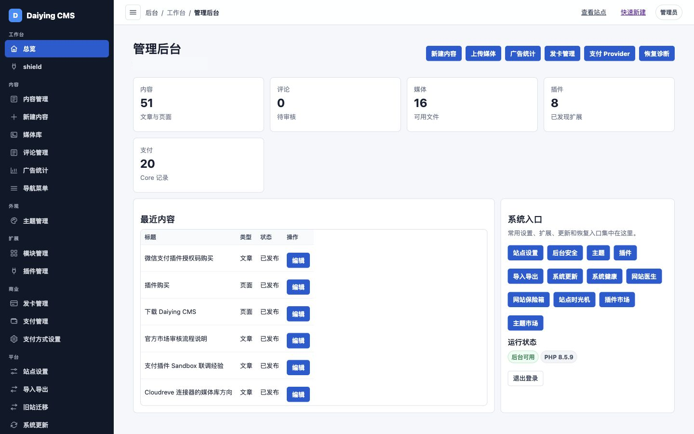
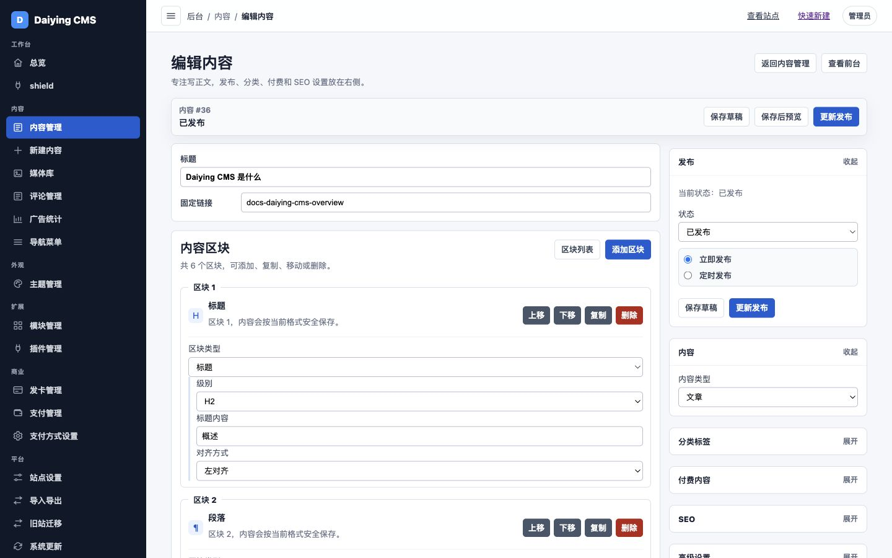
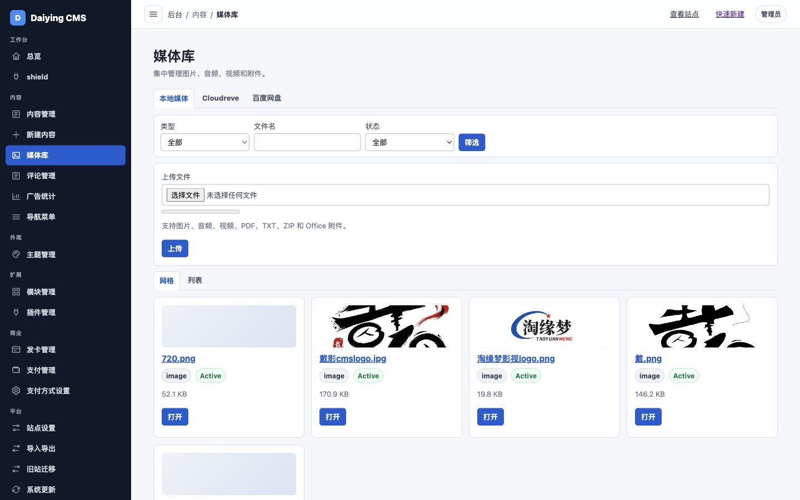
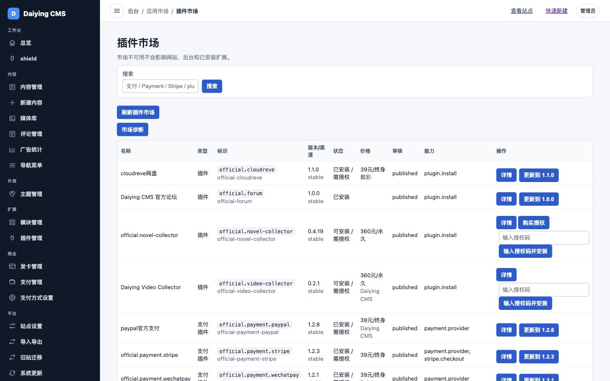
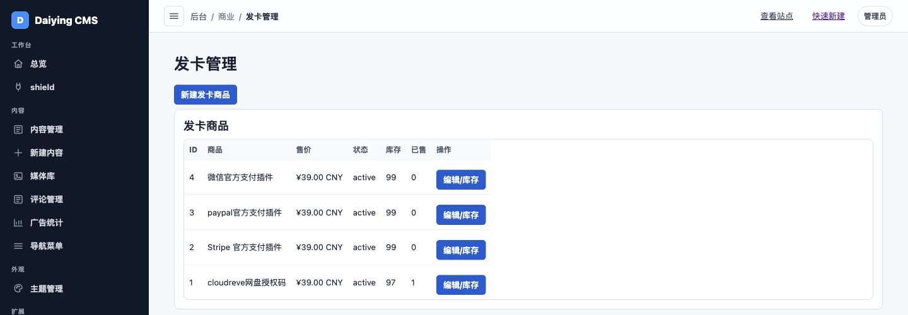
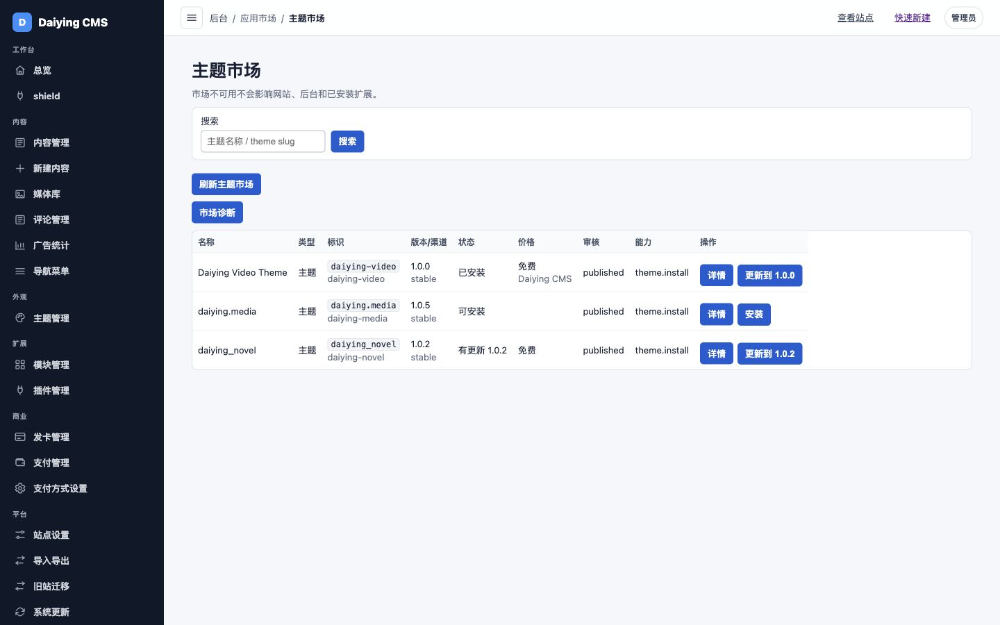
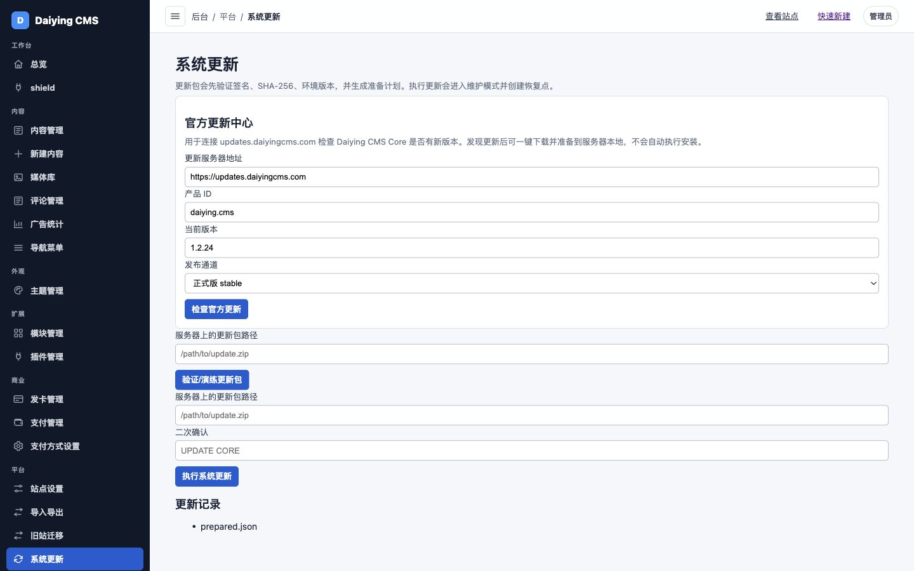

# 戴影CMS（Daiying CMS）

[English](README.en.md) · [中文安装教程](docs/installation.zh-CN.md) · [1.2.100 国内下载](https://gitee.com/daiyingcms/daiying-cms/releases/tag/v1.2.100)

**用自己的服务器，搭建和管理内容网站。**

戴影CMS（Daiying CMS）是一款部署在自有服务器上的 PHP 内容管理系统，面向个人站长、开发者和需要自主维护网站的团队。你可以发布文章和页面、管理图片与文件，选择主题调整外观，通过插件扩展网站功能。

“戴影CMS”“戴影 CMS”和“Daiying CMS”均指本项目。交易基础能力及开发中的外部渠道分发能力，按下文各自的状态与配置要求使用。

**当前正式版：Core 1.2.102**，发布于 **2026-11-21**。最低 PHP **8.3.0**，该正式版已测试 PHP 8.3 / 8.5。版本与安装包以 [GitHub Releases](https://github.com/daixingwei920/daiying-cms/releases/latest) 为准；`main` 可能包含尚未发布的维护代码。



## 项目入口

- [官方网站](https://www.daiyingcms.com/)：项目介绍、中文教程与官方动态。
- [中文安装教程](docs/installation.zh-CN.md)：从环境准备、下载安装到后台登录和检查。
- [文档导航](docs/README.md) · [官网中文文档中心](https://www.daiyingcms.com/docs)。
- [GitHub 主仓库](https://github.com/daixingwei920/daiying-cms) · [Gitee 国内源码镜像](https://gitee.com/daiyingcms/daiying-cms)。
- [1.2.100 国内发行版与附件](https://gitee.com/daiyingcms/daiying-cms/releases/tag/v1.2.100) · [GitHub 正式版](https://github.com/daixingwei920/daiying-cms/releases/latest) · [全部版本记录](https://github.com/daixingwei920/daiying-cms/releases)。
- [问题反馈](https://github.com/daixingwei920/daiying-cms/issues)。
- 插件文档：[docs/plugins.md](docs/plugins.md)
- 主题文档：[docs/themes.md](docs/themes.md)
- 全局 AI：[docs/ai.md](docs/ai.md)

## 你可以用它做什么

- **发布内容**：管理文章、页面、分类、标签与内容区块，搭建个人站或团队内容网站。
- **整理媒体**：统一管理图片、附件及音视频资源，并在内容中引用。
- **调整外观**：安装主题，按主题提供的设置调整页面展示。
- **扩展功能**：通过插件和官方应用市场按需安装扩展，开发者可使用主题规范与 Plugin SDK。
- **辅助写作**：配置站点 AI Provider 后使用相应写作能力；需要自行配置服务与凭据。
- **维护网站**：通过官方更新流程校验包哈希和签名，结合恢复点进行升级与故障恢复。

Commerce 为基础能力 / Beta，外部渠道 Distribution 仍在开发中，详见下文；不同插件、主题和外部服务有各自的配置及授权要求。

## 快速开始

### 1. 环境要求

- PHP 8.3.0 或更高版本。
- PHP 扩展：`pdo`、`json`、`openssl`、`fileinfo`、`zip`。
- 数据库选 SQLite 时启用 `pdo_sqlite`；选 MySQL/MariaDB 时启用 `pdo_mysql`，数据库使用 `utf8mb4`。
- Web 服务器的**文档根目录指向解压目录中的 `public/`**，入口为 `public/index.php`。
- 安装时 `config/`、`storage/` 及上传目录 `content/uploads/` 需要站点 PHP 运行用户具备相应写权限。

### 2. 下载

新站请选择**完整安装包**；已有站点先备份，再通过后台 `/admin/update` 按提示升级，参见[更新文档](docs/update-system.md)。

| Core 1.2.102 正式发布附件 | 入口 |
| --- | --- |
| 完整安装包 | [GitHub 下载](https://github.com/daixingwei920/daiying-cms/releases/download/v1.2.102/daiying-cms-1.2.102-stable.zip) |
| SHA-256 校验文件 | [GitHub 下载](https://github.com/daixingwei920/daiying-cms/releases/download/v1.2.102/daiying-cms-1.2.102-stable.zip.sha256) |
| 签名信息 | [GitHub 下载](https://github.com/daixingwei920/daiying-cms/releases/download/v1.2.102/daiying-cms-1.2.102-stable.zip.signature.json) |
| 版本说明 | [GitHub Release](https://github.com/daixingwei920/daiying-cms/releases/tag/v1.2.102) |

安装包 SHA-256：

```text
ccde6fc241328a5dfdda227b67513a083e03cc43823d10fa9f4611bb388d88cb
```

Gitee 提供 `main` 和正式版标签的单向源码镜像，并为 **1.2.100** 提供旧版完整安装包、校验文件和签名附件的原文件镜像；三个文件已通过公开下载回验，与 GitHub 原件逐字节一致。其他版本和附件以 GitHub 正式 Release 为准。仓库的“克隆/下载”和自动生成的源码 ZIP 用于阅读与开发，不代替正式完整安装包。

### 3. 安装

1. 下载完整安装包和校验文件，按[中文教程](docs/installation.zh-CN.md#下载与校验)核对 SHA-256。
2. 上传并解压安装包，将站点文档根目录设为解压目录中的 `public/`，为域名配置 HTTPS 和对应的 PHP 8.3+ 运行环境。
3. 为站点 PHP 用户设置必要的配置、运行和上传目录写权限。
4. 访问 `https://你的域名/install`，先完成安装器环境检查。
5. 选择 SQLite 或 MySQL/MariaDB，填写配置并点击数据库连接测试。
6. 填写站点名称、公开站点 URL 和管理员信息，提交安装。
7. 访问 `/admin/login` 登录后台，再访问 `/health` 核对安装状态和运行版本。

详细步骤、常见问题及 1.2.100 定时任务配置见：[中文安装教程](docs/installation.zh-CN.md)；[English installation guide](docs/installation.md)。

## 重点能力

### Distribution

**状态：开发中**

Distribution 是 Daiying CMS 当前正在建设的差异化方向，但它不是插件商城、商业授权、授权码交付、Core 更新、Capability Pack、Site Vault 或 Shadow Upgrade。

Distribution 的目标是让站长或卖家只在 Daiying CMS 内完成一次内容或商品资料填写，然后由系统根据已接入的外部渠道进行处理、适配和分发。

概念流程：

```text
内容 / 商品资料
-> 图片 / 视频 / 音频等媒体资源
-> Distribution
-> 选择或匹配外部渠道
-> AI 或规则进行渠道适配
-> Provider / Connector
-> 分发
-> 返回成功、失败、渠道异常或 AI 异常状态
```

当前仓库已经在 `content/plugins/official.commerce` 中包含 alpha 阶段的 Commerce Distribution 实现。它仍不是稳定的 Core 模块，最终 Provider / Connector 规范应继续以合并后的真实实现为准。

### Commerce

**状态：基础能力 / Beta**

Core 已包含支付 Provider 设置、支付记录、付费内容/下载授权和自动发卡。当前仓库内置的 Commerce 插件提供商品和订单基础能力，商品编辑页可以通过 Core 站点 AI，根据管理员已填写的商品字段生成商品介绍草稿。第一版不会抓取外部商品链接；商品链接只作为管理员提供的上下文保留给后续流程。

见：[Commerce 文档](docs/commerce.md)。

### 插件生态

插件可通过本地 ZIP 或官方市场安装。生命周期覆盖 manifest 校验、安全解压、静态扫描、依赖检查、原子安装、数据保留策略、迁移、重装恢复和能力边界。

当前仓库可确认的插件包括：

- `official.commerce`
- `official.friend-links`
- `local.storage.baidu`
- `faq_block`

见：[插件文档](docs/plugins.md)。

### 主题生态

主题独立放在 `content/themes`，通过 `theme.json` 声明主题 ID、版本、兼容 Core、支持内容类型、模板、资源和设置项。

当前仓库可确认的主题包括：

- `default`
- `daiying_media`
- `safe`

见：[主题文档](docs/themes.md)。

历史 `daiying_novel`、`official.novel-collector`、`daiying-video` 和 `official.video-collector` 已于 2026-10-09 退役，不作为当前维护或新装提供的产品宣传。历史源码与已安装用户数据保留，见[退役说明](docs/retired-products.md)。

### 全局 AI Provider 设置

Core 提供可选的站点级 AI Provider 配置和统一 AI Service API，供 CMS 功能和插件复用。DeepSeek、OpenAI、Grok / xAI、腾讯混元和自定义兼容服务共用 OpenAI-compatible Adapter；Gemini 使用原生 Gemini Adapter。内容编辑器可以使用这个服务进行“AI 帮我写”草稿生成，官方插件也可以默认继承站点 AI 设置，不要求管理员重复填写 API Key。AI 层只负责配置、Provider 调用和安全错误处理；文章摘要、SEO、商品描述、渠道适配等具体用途应由插件或业务模块决定。

### 后台安全

管理员可以保留密码登录，同时为已注册 Passkey 的账号使用无密码后台登录。Passkey 凭据限定在管理员账号和当前站点来源内，登录页继续使用 Core 现有认证与 CSRF 边界。

见：[全局 AI](docs/ai.md)。

## 文档

- [文档导航](docs/README.md)
- [中文安装部署](docs/installation.zh-CN.md)
- [开发者入口](docs/developers.md)
- [插件](docs/plugins.md)
- [插件 API v1](PLUGIN_API_V1.md)
- [主题](docs/themes.md)
- [主题 API v1](THEME_API_V1.md)
- [Storage Provider API v1](STORAGE_PROVIDER_API_V1.md)
- [REST API v1](REST_API_V1.md)
- [全局 AI](docs/ai.md)
- [Commerce](docs/commerce.md)
- [Distribution](docs/distribution.md)
- [Update System](docs/update-system.md)
- [Foundation Freeze Checklist](CORE_FOUNDATION_FREEZE_CHECKLIST.md)
- [安全策略](SECURITY.md)
- [贡献指南](CONTRIBUTING.md)

## 更新

已安装站点使用的官方更新服务器：

```text
https://updates.daiyingcms.com
```

生产环境上线前建议运行：

```sh
php scripts/validate_production_readiness.php
php scripts/validate_production_readiness.php --json
php scripts/validate_production_readiness.php --strict
```

版本历史见：[CHANGELOG.md](CHANGELOG.md)。

## 截图

以下为已保存的后台功能截图示例，界面样式以当前安装版本为准。截图采集时已避开、裁剪或遮罩敏感字段、私人文件列表和订单明细。

| 区域 | 截图 |
| --- | --- |
| 内容编辑器 |  |
| 媒体库 |  |
| 插件市场 |  |
| 发卡商业能力 |  |
| 主题市场 |  |
| 在线更新 |  |

截图采集记录见：[DAIYING_CMS_SCREENSHOT_REPORT.md](DAIYING_CMS_SCREENSHOT_REPORT.md)。

## 授权

当前仓库没有 `LICENSE` 文件。项目所有者明确授权方式前，请不要假设第三方可自由复用、分发或商用。
