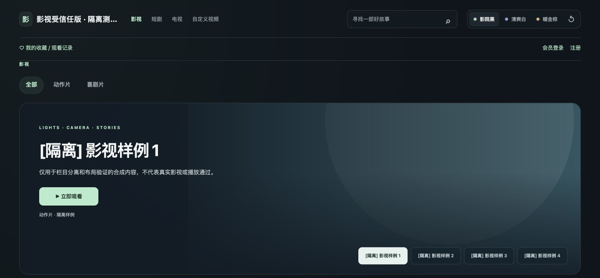
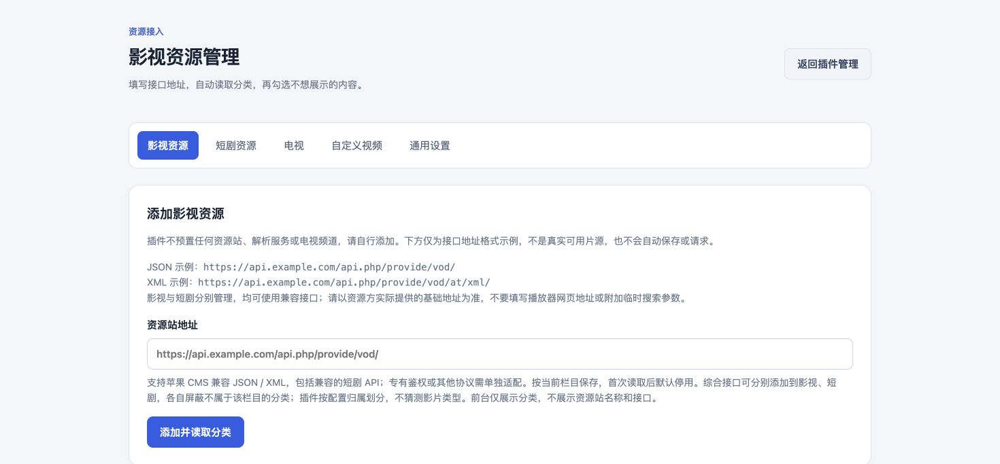
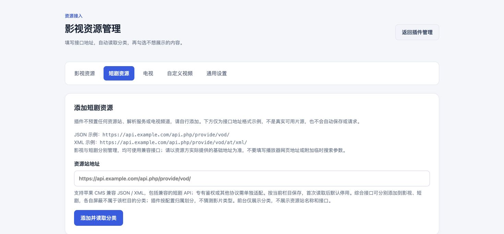
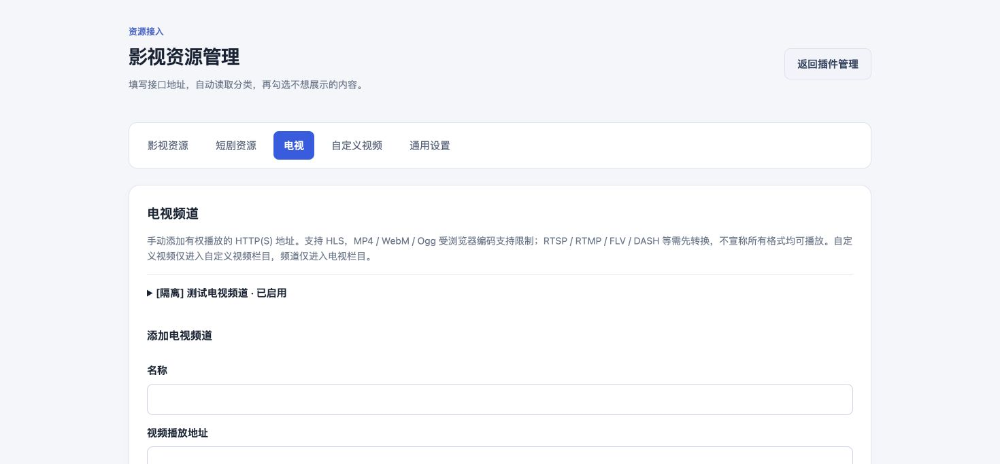
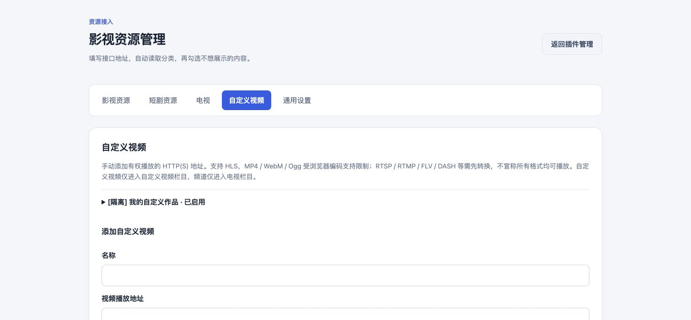
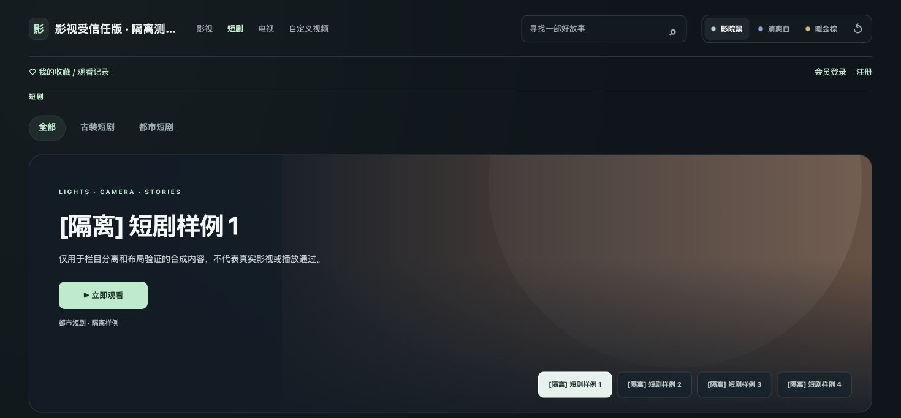
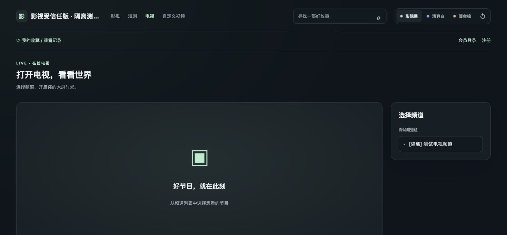

# 戴影影视插件安装与配置图文教程

> 0.8.0 测试版 | 2026-10-21 | 人民币 360 元 单站终身使用

本教程带你完成官方市场安装、影视和短剧资源站配置、电视与自定义视频添加，并设置会员入口、广告、换肤和 App 下载按钮。插件默认不附带任何资源站，安装后由站长自行配置。

## 先了解四个独立栏目

戴影影视资源接入 0.8.0 已在官方市场提供，当前标注为测试版。售价人民币 360 元，一次付费、单站终身使用；不自动承诺终身更新或终身技术支持。

当前市场兼容范围为 Core 1.2.87 至 1.2.88，PHP 8.3 及以上。安装前备份站点，并在后台确认 Core 版本，不要仅凭旧配置文件判断当前活动版本。

前台分为影视、短剧、电视、自定义视频四个栏目，后台分别添加与管理。全站点播搜索覆盖已启用的影视、短剧来源和自定义视频，电视使用独立频道列表。

1. 官方市场安装并启用
2. 分别添加影视和短剧接口
3. 按需添加电视和自定义视频
4. 检查分类屏蔽、会员入口与播放效果

## 安装插件并添加影视资源

在 CMS 后台市场搜索“戴影影视资源接入”，核对标识 official.media-sources、价格与兼容性。通过官方授权流程领取并安装，随后启用。官方受信任 PHP 插件不能用普通本地 ZIP 上传冒充正式授权安装。

进入插件的“影视资源”管理页，填写资源方提供的苹果 CMS 兼容基础接口地址，再点击“添加并读取分类”。首次抓取后来源默认停用，需要继续配置并启用。

`JSON 格式示例  https://api.example.com/api.php/provide/vod/`

`XML 格式示例   https://api.example.com/api.php/provide/vod/at/xml/`

1. 读取分类后，在来源配置中勾选要屏蔽的分类
2. 确认启用该来源并保存；不需要的来源保持停用
3. 到前台影视栏目检查分类与影片列表；名称和接口地址不作为前台栏目展示
4. 如资源需要专有密钥或非标准鉴权协议，先核对兼容性，不要把密钥粘贴进公开文章或群截图

## 独立添加短剧与屏蔽分类

切换后台“短剧资源”，添加资源方提供的兼容 API。短剧来源和影视来源分别保存，前台“短剧”只读取归入本栏目的内容与分类。

同一个综合资源站可以分别添加到影视和短剧，然后在各自配置中屏蔽不属于该栏目的分类。插件按后台配置归属分栏，不会根据片名自动判断短剧。

1. 先读取短剧接口分类，再屏蔽不适合展示的内容
2. 检查启用状态并保存，在前台短剧栏目核对结果
3. 影视和短剧可分别添加多个来源，资源站数量合计上限为 12
4. 调整来源归属后保留来源 ID；不要用删除重建代替不必要的移栏

## 添加电视直播频道

后台“电视”管理的是频道播放地址，不是影视采集接口。填写频道名称、分组、播放地址与合适的类型，启用后保存。前台电视页显示分组频道列表。

优先使用片源方提供的可用 HTTPS 地址。HLS 直播常见为 m3u8，但扩展名不能代替实际流格式和编码检查。HTTPS 网站加载 HTTP 片源可能受到浏览器混合内容限制。

1. 添加一条可用频道后先验证，再批量补充其他频道
2. 确认频道是否有地区、IP、域名或时效访问条件
3. 出现 403、404 或超时时，记录实际出口与响应，不据此推断国内或全球都不可播放
4. 不修改签名地址，不关闭证书检查，也不通过破解或代理绕过访问限制

## 添加自定义视频

后台“自定义视频”用于添加自己的视频播放地址。填写视频名称、分类、地址与类型，启用后保存。前台自定义视频栏目只显示这类内容，不混入影视或短剧列表。

可添加浏览器支持的直链媒体或 HLS 地址；实际播放仍取决于容器、音视频编码、网络、HTTPS 和跨域条件。网页地址不等同于可直接播放的媒体地址。

1. 先确认地址本身可播放，再保存到插件
2. 检查前台分类、标题、选集或播放入口是否正确
3. 分享截图时遮住含密钥、令牌或签名参数的私人地址
4. 站点使用子目录安装时，入口会适配 CMS 的安装路径

## 配置换肤会员广告和下载入口

后台“通用设置”保留三种内置换肤、解析、广告映射、反馈与追剧入口、App 下载按钮及可选首页。没有外部主题时仍使用现有布局。

名称、Logo、会员注册登录和广告复用 CMS 的站点级配置，不需要在插件中另建会员体系。用户登录后可收藏视频并保留观看记录。

反馈和追剧入口可分别填写 CMS 已发布、已开启评论的文章链接。先到 CMS 创建文章并检查评论区，再复制前台链接；不要填写后台编辑或预览地址。

App 下载按钮填写你自己的下载页面或安装包地址，保存后在共用导航中显示，留空隐藏。它不会自动创建打包任务。

安装插件默认保留 CMS 原首页。只有管理员明确选择“将影视设为站点首页”后，站点根地址才显示影视首页；也可以恢复原首页。

1. 配置广告映射后，用实际前台页面确认广告位效果
2. 使用已发布文章的评论入口承接反馈或追剧留言
3. App 下载地址可以自定义，不预设开发者站点
4. 将插件设为首页是可选操作，不会因安装而自动接管

## 前台使用与解析边界

访客在影视或短剧栏目浏览分类、搜索片名，再打开详情选择集数或线路。搜索会覆盖后台已启用的影视、短剧来源及自定义视频；电视不混入点播搜索。

资源方提供的 m3u8/HLS 直链可交给内置播放器。兼容的 JSON 解析服务可在后台配置；金鹰适配仅处理已登记的 HLS 直链，不是万能网页解析，也不破解 VIP、鉴权或 DRM。

当前为 0.8.0 测试版。iPhone/Safari 真机、非生产 HTTPS 与长期实播仍需站点自行验收；竖屏视频目前仍使用 16:9 画框。不要把单个样例播放成功理解为所有格式、地区和片源均可用。

1. 来源列表为空：检查是否抓取成功、启用并保存
2. 分类或影片缺失：核对栏目归属、屏蔽策略与上游返回
3. 播放失败：区分接口错误、媒体地址失效、网络与浏览器解码问题
4. AI 增强尚在规划中，当前使用普通功能不要求配置 AI

## 上线前最后检查

先在测试环境完成下面的清单，再安排自己的生产站点上线。官方市场发布不会自动升级你的站点，也不会自动添加资源站。

已有 daiying.media-sources 0.6.x 安装属于旧插件身份，不是 official.media-sources 的直接覆盖升级。先备份并确认配置、收藏和观看记录的迁移安排，不能同时启用同路由的两个身份。

1. 核对 Core、PHP、授权站点和已启用版本
2. 确认影视与短剧独立分栏，屏蔽策略已保存
3. 验证至少一条影视、一条短剧，以及实际要用的电视或自定义视频
4. 测试会员登录、收藏、观看记录和反馈链接
5. 检查 Logo、站点名称、广告、三种换肤和 App 下载入口
6. 需要影视首页时显式选择，并验证可恢复原首页
7. 在自己的电脑和手机、真实 HTTPS 与目标地区网络验收
8. 保留备份；不要把授权码、私人接口或播放密钥放进公开教程

## 官方信息

- 官网：https://www.daiyingcms.com/
- 在 CMS 后台市场搜索：戴影影视资源接入
- 官方版本记录：https://updates.daiyingcms.com/api/v1/products/official.media-sources/latest?channel=stable

图中均为隔离环境的界面演示，不随插件提供真实资源站、频道或视频。授权码及私人接口不会放入本文档或公开仓库。
